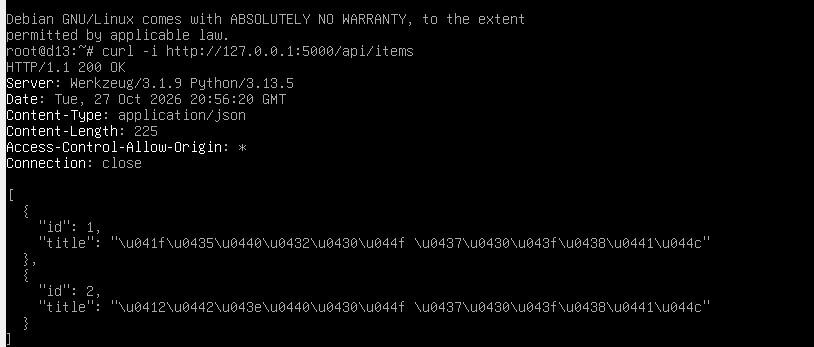
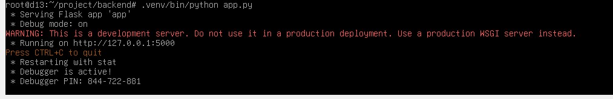
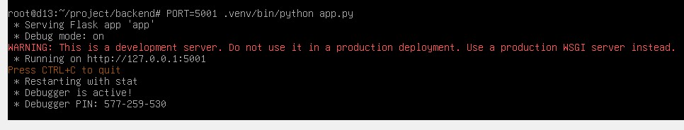
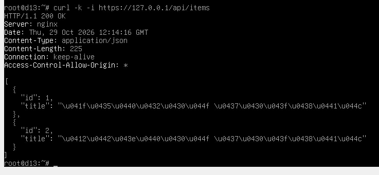
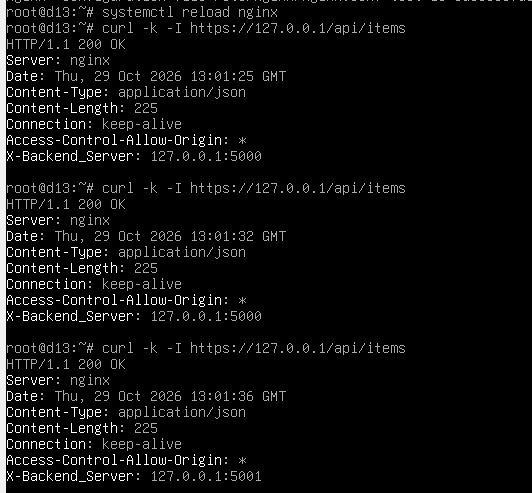
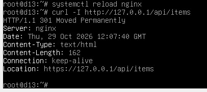
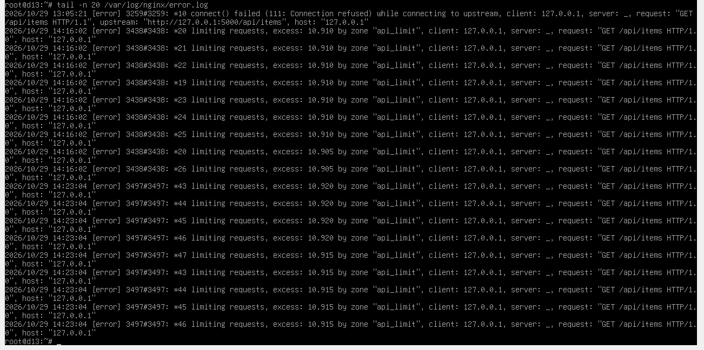
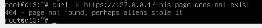
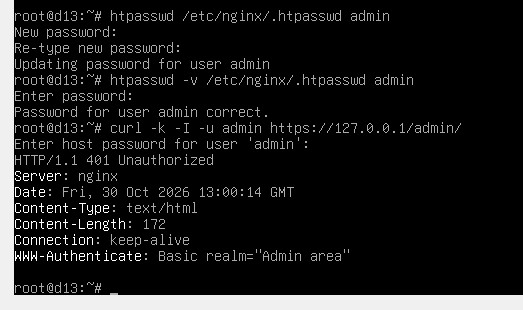
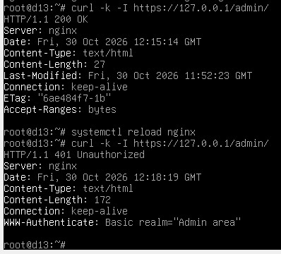

# Лабораторная работа №1. Настройка Nginx

## Задание

Настроить веб-сервер Nginx, который будет выступать в качестве точки входа для веб-приложения, и убедиться, что его не взломают иностранные хакеры, не задудосят злые школьники и не положит внезапный наплыв студентов за день до дедлайна.

## Ход работы

### Установка Nginx: две минуты работы и тридцать минут ожидания

Начала я свою работу с маленького испуга. Я точно помнила, что в прошлом семестре у меня была яркая мысль удалить Oracle VirtualBox за все муки, которые я пережила, пока пыталась разобраться с этой штукой во время курса по основам Linux. К своему превеликому счастью, я всё-таки нашла его на компе целым и нетронутым, а значит, можно приступать к работе.

В качестве операционной системы используем Debian 13, установленную ещё во времена введения в ОС Linux на VirtualBox. Для установки веб-сервера Nginx и необходимых инструментов выполняем команду:

```bash
apt install nginx apache2-utils curl -y
```

И вот тут вы, наверное, подумаете, что запороть данный этап своей работы невозможно (хотя, скорее всего, вы видели и хуже). Но я умудрилась! Прописав эту команду, я стала ожидать скачивания...

<p align="center">
  
</p>

Однако даже спустя 30 минут так ничего и не скачалось. Тогда и только тогда в моей памяти разблокировались знания, полученные на курсе всё того же введения в Linux, о том, что мой дорогой zapret, позволяющий мне впустую тратить время на просмотр видео на ютубчике, не позволяет закачивать пакеты в VirtualBox. После чего он был мгновенно отключен, а скачка заняла всего 2 минуты.

После установки проверяем, что Nginx действительно появился в системе, с помощью команды:

```bash
nginx -v
```


Далее подготавливаем отдельную конфигурацию для лабораторной работы, чтобы не смешивать её со стандартными настройками Nginx. Для этого используем каталог `"/etc/nginx/sites-available/"`, в котором создаём файл:

```bash
nano /etc/nginx/sites-available/lab
```

Чтобы Nginx начал использовать новую конфигурацию, создаём символическую ссылку:

```bash
ln -s /etc/nginx/sites-available/lab /etc/nginx/sites-enabled/lab
```

Стандартную конфигурацию сайта отключаем, чтобы она не конфликтовала с настройками лабораторной работы:

```bash
rm /etc/nginx/sites-enabled/default
```

Таким образом, Nginx установлен и подготовлен к дальнейшей настройке. Теперь нужно объяснить ему, куда отправлять запросы и что делать, если один из серверов решит взять выходной.

### Клонирование Flask

В качестве backend используем Flask-приложение из предыдущей лабораторной работы, предоставляющее API для получения списка записей по адресу `"/api/items"`. Перед началом работы выясняем, что для балансировки нагрузки его придётся доработать.

Пришлось идти разбираться в бэкенде, а там, как назло, ни одного комментария. Автор кода явно не раз страдал от того, что в других проектах не оставлял комментариев, а потом сидел и разбирался в коде двухмесячной давности, но урок так и не усвоил. Я-то знаю, автор бэкенда в нашей команде - это я.

Для балансировки нагрузки необходимо запустить два экземпляра приложения одновременно. Чтобы они не пытались занять один и тот же порт, добавляем в код приложения возможность выбирать порт запуска через переменную окружения `PORT`:

```python
import os
app.run(debug=True, port=int(os.environ.get("PORT", 5000)))
```



Первый экземпляр приложения запускаем стандартным способом:

```bash
.venv/bin/python app.py
```



Второй экземпляр запускаем с указанием другого порта:

```bash
PORT=5001 .venv/bin/python app.py
```



Таким образом, оба экземпляра приложения могут работать одновременно и независимо друг от друга. Осталось настроить Nginx так, чтобы он распределял запросы между ними, а не отправлял все к одному несчастному Flask.

### Раз Flask, два Flask

Для распределения запросов между двумя экземплярами Flask в конфигурации Nginx создаём группу `upstream`:

```nginx
upstream flask_backend {
    server 127.0.0.1:5000;
    server 127.0.0.1:5001;
}
```

Группа `flask_backend` содержит адреса обоих backend-серверов. Nginx использует её для распределения поступающих запросов между доступными экземплярами.

Чтобы запросы к API попадали в эту группу, настраиваем отдельный блок:

```nginx
location /api/ {
    proxy_pass http://flask_backend;
    proxy_set_header Host $host;
    proxy_set_header X-Real-IP $remote_addr;
    add_header X-Backend-Server $upstream_addr always;
}
```

Параметр `proxy_pass` передаёт запросы группе backend-серверов. Заголовки `Host` и `X-Real-IP` позволяют передать приложению информацию об исходном запросе.

Дополнительно настраиваем заголовок `X-Backend-Server`, чтобы можно было определить, какой именно экземпляр приложения обработал запрос. Это пригодится при проверке балансировки: мало ли, вдруг Nginx просто делает вид, что работает.

Для начала проверяем, что API вообще доступен через Nginx:

```bash
curl -k -i https://127.0.0.1/api/items
```

В результате сервер возвращает код `200 OK`, JSON с записями и заголовок `X-Backend-Server`.



Затем несколько раз подряд отправляем запрос к API:

```bash
curl -k -I https://127.0.0.1/api/items
```

В ответах поочерёдно появляются адреса `127.0.0.1:5000` и `127.0.0.1:5001`. Это подтверждает, что Nginx распределяет запросы между двумя экземплярами backend.



### Замочек для своих

Балансировка работает, но оставлять приложение доступным только по обычному HTTP было бы не очень безопасно. Поэтому следующим этапом настраиваем HTTPS.

Для организации защищённого соединения создаём самоподписанный SSL-сертификат с помощью OpenSSL. Сертификат сохраняем в `"/etc/nginx/ssl/lab.crt"`, а закрытый ключ в `"/etc/nginx/ssl/lab.key"`.

В конфигурации Nginx настраиваем сервер, принимающий HTTPS-соединения на порту 443:

```nginx
server {
    listen 443 ssl default_server;
    server_name _;

    ssl_certificate /etc/nginx/ssl/lab.crt;
    ssl_certificate_key /etc/nginx/ssl/lab.key;
}
```

Но одного HTTPS недостаточно: пользователь всё ещё может попытаться обратиться к приложению по обычному HTTP. Чтобы перенаправлять такие запросы на защищённое соединение, настраиваем отдельный сервер на порту 80:

```nginx
server {
    listen 80 default_server;
    server_name _;

    return 301 https://$host$request_uri;
}
```

Код ответа `301 Moved Permanently` сообщает клиенту, что запрашиваемый ресурс доступен по новому адресу с использованием HTTPS.

Проверяем перенаправление командой:

```bash
curl -I http://127.0.0.1/api/items
```

В результате получаем ответ `301 Moved Permanently` с адресом HTTPS в заголовке `Location`.



При проверке HTTPS-запросов с помощью `curl` используем параметр `-k`, поскольку созданный сертификат является самоподписанным и не входит в список доверенных центров сертификации. Иными словами, сертификат у нас есть, но официально за него никто не поручился.

### Папка под псевдонимом

Помимо проксирования запросов к backend, Nginx должен самостоятельно обрабатывать запросы к статическим ресурсам. Для этого создаём отдельную директорию:

```bash
mkdir -p /var/www/docs
```

В ней создаём файл `index.html`.

Для обращения к содержимому директории через адрес `/docs/` добавляем в конфигурацию Nginx блок:

```nginx
location /docs/ {
    alias /var/www/docs/;
    index index.html;
}
```

Директива `alias` связывает URL-путь `/docs/` с физическим каталогом `/var/www/docs/`. Это позволяет Nginx отдавать статические файлы самостоятельно, не обращаясь к Flask.

Для проверки используем команду:

```bash
curl -k https://127.0.0.1/docs/
```

В ответе отображается содержимое созданной HTML-страницы. Значит, хотя бы документы теперь можно получить без участия backend, который и так занят распределением запросов.

### Один Nginx, два сайта

Следующим этапом проверяем, сможет ли один Nginx обслуживать несколько сайтов. Для этого создаём отдельный каталог:

```bash
mkdir -p /var/www/site2
```

В нём размещаем собственную HTML-страницу с текстом `Second virtual host`.

В конфигурацию Nginx добавляем отдельный сервер:

```nginx
server {
    listen 443 ssl;
    server_name site2.local;

    ssl_certificate /etc/nginx/ssl/lab.crt;
    ssl_certificate_key /etc/nginx/ssl/lab.key;

    root /var/www/site2;
    index index.html;
}
```

Параметр `server_name` определяет имя виртуального хоста, а `root` указывает директорию, из которой Nginx должен отдавать статические файлы.

Для проверки используем команду:

```bash
curl -k --resolve site2.local:443:127.0.0.1 https://site2.local/
```

Параметр `--resolve` позволяет направить запрос к указанному IP-адресу, сохранив имя хоста в HTTP-запросе.

В результате получаем страницу `Second virtual host`, что подтверждает корректную работу второго виртуального хоста. Теперь один Nginx может обслуживать несколько сайтов, не заставляя их драться за одну директорию.

### Спокойно, по одному

Балансировка нагрузки помогает распределять запросы между backend-серверами, но не защищает API от ситуации, когда запросов становится слишком много. Для этого настраиваем директиву `limit_req`.

Сначала создаём общую зону хранения состояния запросов:

```nginx
limit_req_zone $binary_remote_addr zone=api_limit:10m rate=5r/s;
```

В данном случае `$binary_remote_addr` используется для определения IP-адреса клиента, `api_limit` это имя зоны, `10m` размер выделяемой памяти, а `5r/s` допустимая средняя частота запросов, то есть пять запросов в секунду.

Затем подключаем ограничение к обработчику API:

```nginx
limit_req zone=api_limit burst=10 nodelay;
limit_req_status 429;
```

Параметр `burst=10` разрешает временное превышение установленной частоты в пределах десяти запросов. Параметр `nodelay` отключает задержку для запросов, попавших в допустимый предел превышения.

При превышении лимита Nginx возвращает код `429 Too Many Requests`. Для проверки выполняем серию запросов к API, а срабатывание ограничения отслеживаем в журнале ошибок Nginx:

```bash
tail -f /var/log/nginx/error.log
```

В журнале появляются сообщения `limiting requests`, подтверждающие работу `limit_req`. То есть Nginx не просто молча страдает от наплыва запросов, а вполне конкретно сообщает, что пора немного успокоиться.



### Здесь ничего нет, но мы об этом предупредим

Даже при правильной настройке сайта пользователь может запросить страницу, которой не существует. Чтобы в таком случае не показывать стандартную ошибку Nginx, создаём отдельную директорию:

```bash
mkdir -p /var/www/errors
```

В ней создаём файл `404.html` с собственным текстом ошибки.

В конфигурацию HTTPS-сервера добавляем директивы:

```nginx
error_page 404 /404.html;

location = /404.html {
    root /var/www/errors;
    internal;
}
```

Директива `error_page` задаёт страницу, которая будет возвращаться при возникновении ошибки 404. Параметр `internal` запрещает прямое обращение пользователя к этой странице. Она используется Nginx только при обработке соответствующей ошибки.

Для проверки отправляем запрос к несуществующему адресу:

```bash
curl -k https://127.0.0.1/this-page-does-not-exist
```

В ответе отображается содержимое созданной страницы ошибки. Если пользователь всё-таки заблудился на сайте, Nginx хотя бы встретит его не стандартной сухой ошибкой.



### Пароль есть, доступа нет

Для ограничения доступа к разделу `/admin/` настраиваем базовую HTTP-аутентификацию. Сначала создаём директорию и HTML-страницу администратора:

```bash
mkdir -p /var/www/html/admin
echo "Welcome to admin panel" > /var/www/html/admin/index.html
```

Для хранения учётных данных используем утилиту `htpasswd`:

```bash
htpasswd -c /etc/nginx/.htpasswd admin
```

Команда создаёт файл `.htpasswd` и добавляет пользователя `admin`. Пароль вводится интерактивно и сохраняется в виде хеша, а не открытого текста. Файл с учётными данными размещаем в `/etc/nginx/`, вне директории проекта.

Для защиты раздела администратора добавляем в конфигурацию блок:

```nginx
location /admin/ {
    root /var/www/html;
    index index.html;
    auth_basic "Admin area";
    auth_basic_user_file /etc/nginx/.htpasswd;
}
```

Директива `auth_basic` включает базовую HTTP-аутентификацию, а `auth_basic_user_file` указывает путь к файлу с учётными данными.

При первой проверке сервер не принимает пароль, хотя учётные данные введены корректно.

И вот тут я присела. Когда сервер во второй раз показал, что пароль неправильный, я подумала, что при его задании дважды допустила одну и ту же ошибку, поэтому пошла и пересоздала его снова. Однако и это не помогло, и, дабы удостовериться, что это не мои кривые руки косячат, я задала в качестве пароля один символ и попыталась снова. Не бомбануло..... А у меня бомбануло! Да так, что, уставшая и обидевшаяся, я пошла бороться с шоколадкой в холодильнике.


Вернувшись, я продолжила разбираться с проблемой. К сожалению, мои попытки выучить латынь не привели к призыву демона, поэтому, в отличие от того парня из эталонного отчёта, мне пришлось разбираться со всем самой.

Для проверки пароля пользователя `admin` используем команду:

```bash
htpasswd -v /etc/nginx/.htpasswd admin
```

Утилита подтверждает, что пароль правильный. Значит, проблема не в пароле, а где-то в конфигурации Nginx. Для поиска ошибки выполняем команду:

```bash
grep -n 'auth_basic_user_file' /etc/nginx/sites-available/lab
```

Она показывает, что в директиве `auth_basic_user_file` указан неверный путь: вместо `/etc/nginx/.htpasswd` используется файл SSL-сертификата `/etc/nginx/ssl/lab.crt`. После исправления пути авторизация начинает работать.

Проверку выполняем в двух режимах. Сначала отправляем запрос без указания логина и пароля:

```bash
curl -k -I https://127.0.0.1/admin/
```

Сервер возвращает `401 Unauthorized`, что подтверждает запрет доступа без авторизации.

Затем выполняем проверку с использованием созданной учётной записи:

```bash
curl -k -I -u admin https://127.0.0.1/admin/
```

После ввода правильного пароля сервер возвращает `200 OK`. Таким образом, доступ к разделу администратора предоставляется только после успешной аутентификации. В итоге победили не иностранные хакеры, не злые школьники и даже не я, а одна неправильно указанная строчка конфигурации.





### Минус один Flask

Остаётся проверить, что произойдёт, если один из backend-серверов всё-таки перестанет работать. Для этого временно останавливаем один из экземпляров Flask, запущенный на порту 5000.

После остановки первого backend отправляем запрос к API через Nginx:

```bash
curl -k -i https://127.0.0.1/api/items
```

Несмотря на остановку одного экземпляра приложения, Nginx продолжает обрабатывать запросы и передавать их второму backend, работающему на порту 5001.

В ответе получаем код `200 OK`, JSON с записями и заголовок `X-Backend-Server`, содержащий адрес `127.0.0.1:5001`.

Это подтверждает, что при недоступности одного из backend-серверов запросы могут обрабатываться оставшимся экземпляром. После проверки восстанавливаем работу первого экземпляра Flask.


### Финальный рубеж

После внесения изменений проверяем конфигурацию Nginx командой:

```bash
nginx -t
```

При успешной проверке применяем изменения:

```bash
systemctl reload nginx
```

Для проверки состояния службы используем команду:

```bash
systemctl status nginx
```

В результате Nginx успешно проходит проверку конфигурации и находится в состоянии `active (running)`.


А чтобы убедиться, что нигде по пути настройки я не сломала что-то уже настроенное, я ещё раз на всякий случай прогнала проверки всех ранее проделанных махинаций.

## Вывод

Всё работает. Иностранные хакеры остановлены HTTPS и паролем, злые школьники упёрлись в limit_req, а внезапный наплыв студентов разобрали два экземпляра Flask. Ничего не поломалось. А я молодец.
